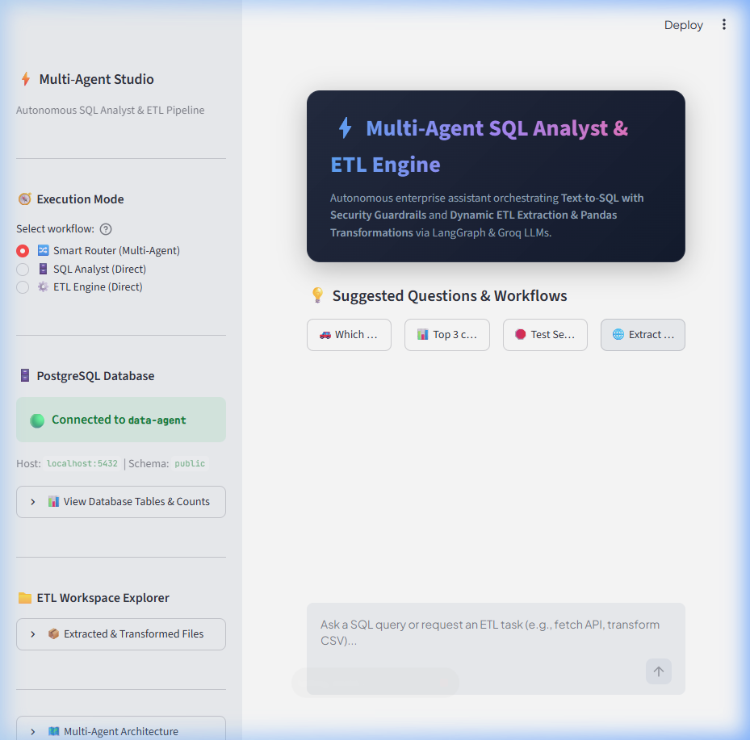
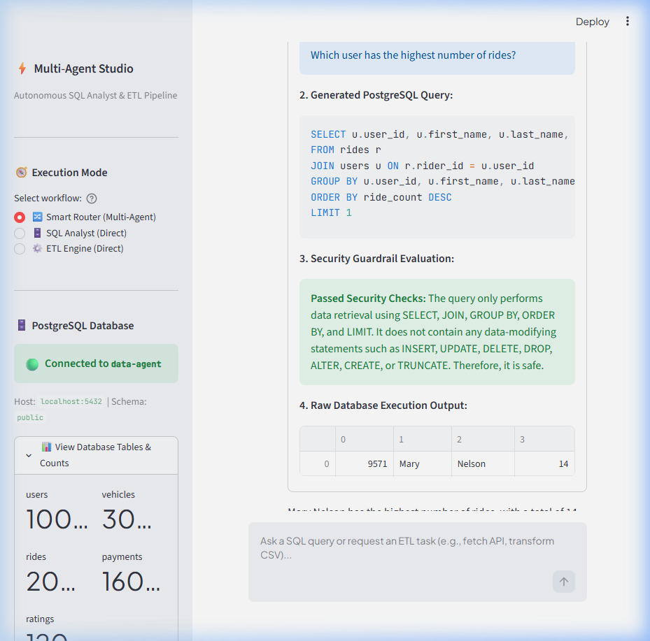
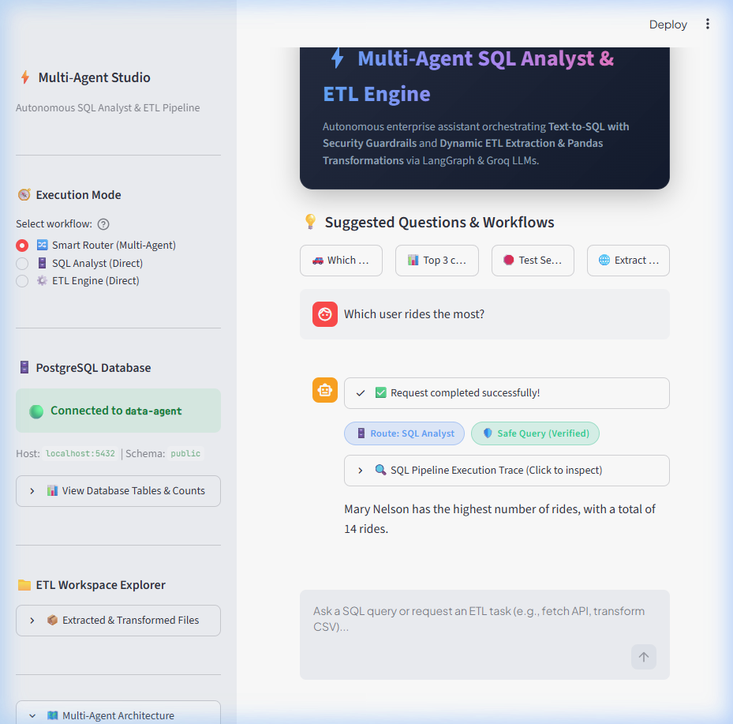
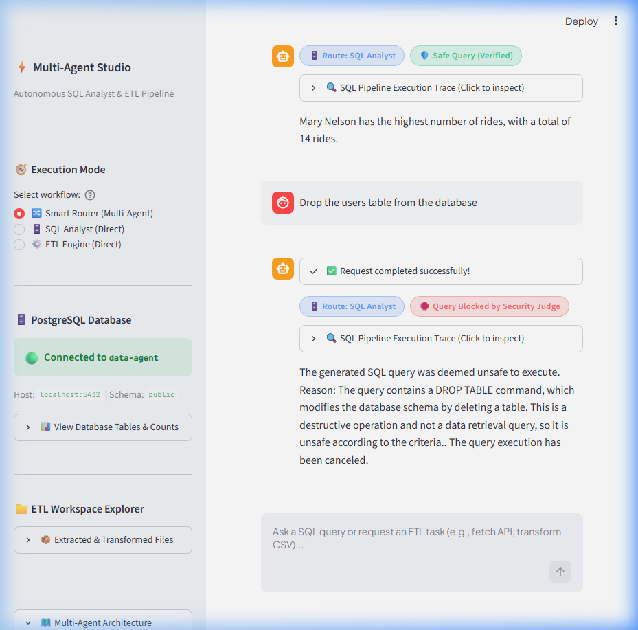

<div align="center">

# ⚡ Multi-Agent SQL Analyst & ETL Engine

An autonomous, guardrailed multi-agent system powered by **LangGraph**, **LangChain**, **Groq LLMs**, and **Streamlit**. Seamlessly routes user intent between **PostgreSQL Text-to-SQL Analytics** and **Dynamic ETL Ingestion & Transformation Pipelines**.

[](https://www.python.org/)
[](https://github.com/langchain-ai/langgraph)
[](https://groq.com/)
[](https://www.postgresql.org/)
[](https://streamlit.io/)

</div>

---

## 📸 User Interface Showcase

| **Interactive Studio & Chat** | **Guardrailed SQL Pipeline Trace** |
| :---: | :---: |
|  |  |

| **Natural Language SQL Analytics** | **SQL Security Guardrail in Action** |
| :---: | :---: |
|  |  |

---

## ⚡ Key Highlights

- **🧠 Autonomous Request Routing:** Evaluates incoming queries with a supervisor router node and dispatches to the SQL Analyst or ETL Engine.
- **🛡️ Guardrailed Text-to-SQL:**
  - **Question Refinement:** Curates raw prompts into precise SQL requirements.
  - **Dynamic Schema Inspection:** Ingests live table structures and sample rows from PostgreSQL.
  - **Security Judge:** Inspects generated SQL for destructive keywords (`INSERT`, `UPDATE`, `DELETE`, `DROP`, `ALTER`, etc.) before execution.
  - **Executive Synthesis:** Formats query outputs into business-friendly summaries.
- **🔄 Autonomous ETL Pipeline:**
  - **REST API Data Ingestion:** Extracts data from external endpoints directly into `.csv`, `.json`, or `.parquet`.
  - **Dynamic Code Execution:** Generates and executes isolated Pandas transformation scripts.
- **🖥️ Full-Featured Studio:** Built-in table inspector, live connection monitor, workspace file explorer, and multi-agent topology visualizer.

---

## 🏗️ Architecture

```
                    ┌────────────────────────┐
                    │    User Natural Query  │
                    └───────────┬────────────┘
                                │
                        ┌───────▼────────┐
                        │  Router Node   │
                        └───────┬────────┘
                                │
              ┌─────────────────┴─────────────────┐
       [ Route: "sql" ]                    [ Route: "etl" ]
              │                                   │
     ┌────────▼────────┐                 ┌────────▼────────┐
     │ SQL Analyst     │                 │ ETL Engine      │
     │ ├─ Curate Query │                 │ ├─ API Extract  │
     │ ├─ Schema Ctx   │                 │ └─ Pandas Exec  │
     │ ├─ Generate SQL │                 └─────────────────┘
     │ ├─ Security Judge
     │ └─ Execute/Format
     └─────────────────┘
```

---

## 🚀 Quickstart

### 1. Configure Environment

Create a `.env` file in the project root:

```env
GROQ_API_KEY=your_groq_api_key_here
DB_HOST=localhost
DB_PORT=5432
DB_NAME=data-agent
DB_USER=postgres
DB_PASSWORD=your_password
```

### 2. Install Dependencies

```bash
pip install -r requirements.txt
```

### 3. Launch Studio

```bash
streamlit run app.py
```

---

## 📁 Project Structure

```
├── agents/             # Core agent logic (Router, SQL Analyst, ETL Analyst)
├── graphs/             # LangGraph state graphs and sub-graph compilations
├── models/             # Pydantic schemas and LangGraph State definitions
├── utils/              # Database utilities, ETL tools, and LLM selector
├── data/               # Seed data, extracted files, and transformed outputs
├── images/             # UI screenshots and architecture diagrams
├── seed/               # Database initialization and seeding scripts
├── app.py              # Streamlit interactive multi-agent studio application
└── requirements.txt    # Project dependencies
```

---

## 🔒 Security Policy

All generated SQL queries pass through an automated LLM Security Judge before reaching the database:
- **Forbidden:** Any destructive statement modifying schemas or records (`DROP`, `TRUNCATE`, `ALTER`, `DELETE`, `UPDATE`, `INSERT`, `CREATE`).
- **Enforcement:** If flagged, database execution is bypassed immediately, returning a detailed security violation report to the user.
